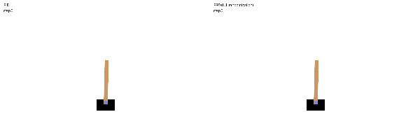
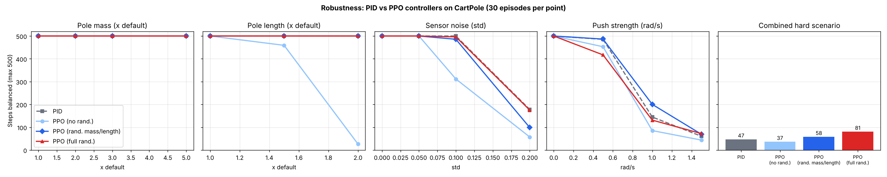

# Deep RL vs PID Control under Real-World Disturbances

A deep reinforcement learning controller (PPO, PyTorch) that balances an inverted pendulum. It is benchmarked against a classical PID controller under the kinds of disturbances real machines face (heavier loads, longer arms, sensor noise, external pushes). The trained policy is deployed in C++ through ONNX Runtime, and as ROS2 nodes.


*One illustrative episode (sensor noise 0.15, random pushes 0.5 rad/s). Over 50 episodes in this setting, the average is PID 174 steps vs PPO 218 steps.*

## Key results



| | PID | PPO, no randomization | PPO, mass/length randomized | PPO, full randomization |
|---|---|---|---|---|
| Nominal conditions | 500 / 500 | 500 / 500 | 500 / 500 | 500 / 500 |
| Pole 2x longer | 500 | **27** | 500 | 500 |
| Sensor noise std 0.2 | 178 | 57 | 99 | 175 |
| Combined hard scenario* | 47 | 37 | 58 | **81** |
| Average, all single-disturbance tests | 425 | 363 | 423 | 419 |

\*3x pole mass, 1.5x length, sensor noise 0.1, random pushes 1.0 rad/s. 30 seeded episodes per cell, with the same seeds for every controller. A recheck on 200 fresh episodes gave PID 55–58 and full-randomization PPO 79–89.

**Findings:**
1. **An RL agent trained on one setting is brittle.** The no-randomization PPO collapses (500 → 27 steps) when the pole is twice as long, a condition it never saw in training.
2. **What you randomize matters.** Randomizing only mass and length did not help against noise or pushes. Those are what actually break controllers here. Adding them to training (v2) made PPO match PID on noise.
3. **Under combined disturbances, fully randomized PPO lasted ~70% longer than PID** (81 vs 47 steps).
4. **PID is a strong baseline.** On single disturbances it matches or beats every RL agent. On a simple, well-understood system, classical control is hard to beat. RL's advantage shows up when several disturbances act together.
5. **Deployment:** the exported policy runs in C++ at about **3 µs per decision**, against a 20 ms control period. It gives identical actions to the PyTorch model (100% agreement over 10,000 states).

## Project structure

```
config.yaml                  every setting: seeds, PPO hyperparameters, PID gains, test grid
src/envs.py                  CartPole + disturbance wrappers (mass, length, sensor noise, pushes)
src/pid.py                   PID baseline (bang-bang output, since CartPole has 2 actions)
src/network.py               policy network written in PyTorch, plugged into Stable-Baselines3
scripts/train.py             PPO training: 3 modes, TensorBoard, versioned model folders
scripts/evaluate.py          robustness sweep -> results/robustness.csv, .png, summary.md
scripts/make_gif.py          side-by-side demo GIF
scripts/export_onnx.py       export policy to ONNX + parity check vs PyTorch
cpp/cartpole_onnx.cpp        C++ physics + ONNX Runtime closed-loop control, latency measurement
ros2_ws/src/cartpole_rl_control   ROS2 package: policy_node, sim_node, launch file
```

## How to run

```bash
pip install -r requirements.txt

python scripts/train.py --mode nominal     # ~3 min on CPU each
python scripts/train.py --mode drphys
python scripts/train.py --mode drfull
tensorboard --logdir runs                  # training curves

python scripts/evaluate.py                 # ~2 min
python scripts/make_gif.py
python scripts/export_onnx.py
```

**C++ deployment.** Download the ONNX Runtime release for your OS from github.com/microsoft/onnxruntime/releases. This was tested with 1.22.0 on Linux.

```bash
cmake -S cpp -B cpp/build -DORT_DIR=/path/to/onnxruntime-linux-x64-1.22.0
cmake --build cpp/build
./cpp/build/cartpole_onnx models/policy.onnx 50 3.0   # 50 episodes, 3x pole mass
```

**ROS2** (Humble or newer):

```bash
cd ros2_ws && colcon build && source install/setup.bash
ros2 launch cartpole_rl_control cartpole.launch.py model_path:=$(pwd)/../models/policy.onnx
```

`sim_node` stands in for the machine. It publishes `/cartpole/state` at 50 Hz and logs episode lengths. `policy_node` subscribes to the state and publishes `/cartpole/action`. On real hardware, only the sim node would be replaced, by sensor and motor drivers.

## Method notes

- **Environment:** Gymnasium `CartPole-v1`. Actions are a full push left or right (10 N), and episodes are capped at 500 steps (10 s).
- **PPO setup:** a 2×64 tanh MLP shared trunk with linear actor and critic heads. 300k steps, 4 parallel environments, seed 42.
- **Domain randomization:** each training episode samples pole mass (0.5–3x), length (0.7–1.5x), sensor noise (std 0–0.15) and push strength (0–1.0 rad/s). The test grid goes beyond these ranges (5x mass, 2x length, noise 0.2, pushes 1.5) to check generalization.
- **PID:** u = Kp·θ + Ki·∫θ + Kd·θ̇ + Kx·x + Kxd·ẋ, and the action is the sign of u. The gains were set by hand and checked with a small grid search on nominal conditions.
- **Model selection:** evaluation uses the final checkpoint, not "best", because many checkpoints tie at the 500-step cap.
- **MLOps:** config-driven runs, fixed seeds, TensorBoard logs, a timestamped folder per run with a copy of its config, and an automated parity test for the ONNX export.

## Limitations

- **Simulation only.** Real hardware adds actuator delay, friction and saturation that aren't modelled here.
- **Discrete actions.** Real motors take continuous commands. The next step would be a continuous-action task (e.g. Pendulum, or MuJoCo InvertedPendulum) with SAC.
- **One training seed per agent.** Proper RL comparisons use 3–5 seeds with confidence intervals.
- **Basic PID tuning.** An LQR or gain-scheduled controller would be a stronger classical baseline.
- **The ROS2 nodes weren't run under ROS2 in development.** Their control logic (`core.py`) was tested on its own: the physics matches Gymnasium exactly, and the closed loop balances every test episode.
